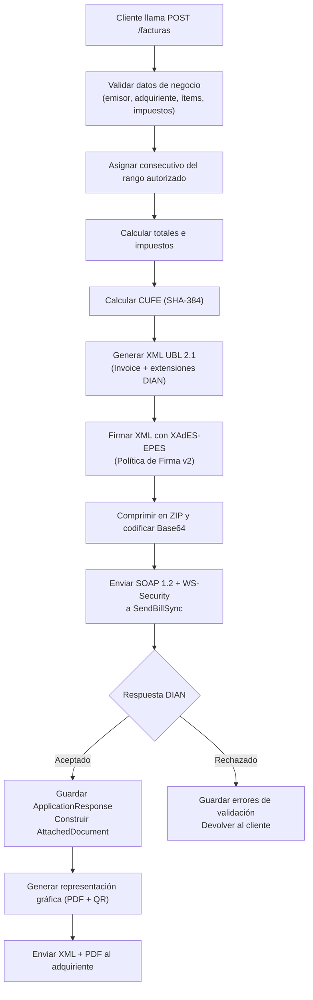

# API de Facturación Electrónica — DIAN Colombia

API propia para **crear, firmar, transmitir y consultar facturas electrónicas de venta** (y sus notas crédito/débito) conectándose directamente a los **servicios web de la DIAN** bajo el modelo de **validación previa**, en modo de operación **Software Propio**.

> [!NOTE]
> Este repositorio está en **fase de investigación y estructura**. Todavía no se ha elegido tecnología.
> La investigación se hizo con búsqueda web respaldada por Google/Gemini y fuentes de la DIAN. **Antes de implementar, verificar cada dato contra el Anexo Técnico vigente.**

---

## 1. Marco normativo

| Norma / documento | Qué define |
|---|---|
| **Resolución DIAN 000165 de 2023** | Unifica el sistema de facturación, adopta el **Anexo Técnico de Factura Electrónica v1.9**, documentos equivalentes electrónicos (POS) y RADIAN. |
| **Anexo Técnico FE v1.9** | Estructura XML (UBL 2.1), reglas de validación, CUFE/CUDE, catálogos (listas de valores), servicios web. |
| **Política de Firma v2 (DIAN)** | Reglas de la firma XAdES-EPES que debe llevar cada XML. |
| **RADIAN** | Registro de la factura como título valor (eventos: acuse, recibo del bien, aceptación/reclamo). |

Cambios clave del Anexo 1.9 que impactan el diseño:
- La **fecha de emisión, firma y transmisión deben coincidir** (mismo día). No se puede “acumular” y enviar después.
- Los datos del emisor deben coincidir **exactamente con el RUT**; si no, rechazo automático.
- Notas crédito/débito: motivos específicos (se eliminó “Otros”); fecha de la factura original obligatoria.
- Nuevos tipos de identificación (p. ej. **PPT**) e impuestos saludables (Ley 2277 de 2022).

---

## 2. Actores y requisitos previos

| Requisito | Dónde se obtiene |
|---|---|
| RUT actualizado con responsabilidad de facturador electrónico | DIAN / MUISCA |
| **Certificado de firma digital** (.p12/.pfx) de una entidad acreditada por ONAC | Certicámara, GSE, Andes SCD, etc. |
| Registro como **Software Propio** → `SoftwareID`, **PIN** y **TestSetId** | Portal de Habilitación DIAN |
| **Resolución de numeración** (prefijo, rango, vigencia) y **Clave Técnica** | MUISCA → asociar en portal de FE |

---

## 3. Flujo completo de una factura



---

## 4. Servicios web de la DIAN

**Endpoints (WCF / SOAP 1.2):**

| Ambiente | URL |
|---|---|
| Habilitación (pruebas) | `https://vpfe-hab.dian.gov.co/WcfDianCustomerServices.svc?wsdl` |
| Producción | `https://vpfe.dian.gov.co/WcfDianCustomerServices.svc?wsdl` |

**Métodos principales:**

| Método | Uso | Ambiente |
|---|---|---|
| `SendTestSetAsync` | Envía documentos del **set de pruebas** usando el `testSetId`. Devuelve un `TrackId`. | Habilitación |
| `SendBillSync` | Envía un documento y recibe la validación **inmediata**. | Ambos (principal en producción) |
| `SendBillAsync` | Envío asíncrono; devuelve `TrackId`. | Ambos |
| `GetStatusZip` | Consulta el resultado de un envío asíncrono por `TrackId`. | Ambos |
| `GetStatus` | Consulta el estado de un documento por CUFE/CUDE. | Ambos |
| `GetNumberingRange` | Consulta rangos de numeración autorizados y la **clave técnica**. | Ambos |
| `GetXmlByDocumentKey` | Descarga el XML validado por CUFE/CUDE. | Ambos |
| `SendEventUpdateStatus` | Registra eventos RADIAN (`ApplicationResponse`). | Ambos |

**Requisitos del mensaje SOAP:**
- **SOAP 1.2** con encabezados **WS-Addressing** (`wsa:Action` con la acción del método, `wsa:To` con la URL del servicio).
- Encabezado **WS-Security**: `wsse:BinarySecurityToken` con el certificado, `wsu:Timestamp` y firma del encabezado.
- El documento viaja como **ZIP → Base64** en el parámetro `contentFile` (más `fileName`, y `testSetId` solo en habilitación).

---

## 5. Piezas técnicas clave

### 5.1 XML UBL 2.1
- Documentos: `Invoice` (factura), `CreditNote`, `DebitNote`, `ApplicationResponse` (respuesta/eventos), `AttachedDocument` (contenedor para el adquiriente).
- Extensiones DIAN en `ext:UBLExtensions`:
  - `UBLExtension[1]` → `sts:DianExtensions` (resolución de numeración, `SoftwareID`, `SoftwareSecurityCode`, `QRCode`, etc.).
  - `UBLExtension[2]` → `ds:Signature` (firma).
- Validar contra los **XSD** y las **listas de valores** del anexo (guardar en [`recursos/`](recursos/)).

### 5.2 CUFE (facturas) y CUDE (notas)
Cadena concatenada **sin separadores**, hash **SHA-384**, resultado en hexadecimal minúscula (96 caracteres), va en `cbc:UUID`:

```
CUFE = SHA384( NumFac + FecFac + HorFac + ValFac
             + "01" + ValIVA + "04" + ValINC + "03" + ValICA
             + ValTot + NitOFE + NumAdq + ClaveTecnica + TipoAmbiente )
```

| Campo | Origen |
|---|---|
| `NumFac` | Prefijo + número (`cbc:ID`) |
| `FecFac` / `HorFac` | `cbc:IssueDate` (`AAAA-MM-DD`) / `cbc:IssueTime` (`HH:MM:SS-05:00`) |
| `ValFac` | Subtotal sin impuestos (`LineExtensionAmount`), 2 decimales |
| `01` / `04` / `03` | Códigos de IVA / INC / ICA con su valor (0.00 si no aplica) |
| `ValTot` | Total a pagar (`PayableAmount`) |
| `NitOFE` / `NumAdq` | NIT del emisor (sin DV) / identificación del adquiriente |
| `ClaveTecnica` | De la resolución de numeración |
| `TipoAmbiente` | `1` producción, `2` habilitación |

- **CUDE** (notas crédito/débito): misma idea, pero usa el **PIN del software** en lugar de la clave técnica.
- **SoftwareSecurityCode** = `SHA384(SoftwareID + PIN + NumFac)`.

### 5.3 Firma digital XAdES-EPES
- Firma *enveloped* dentro de `UBLExtension[2]`.
- Incluye `SignedProperties` (hora de firma, certificado firmante) y `SignaturePolicyIdentifier` que apunta a la **Política de Firma v2** de la DIAN con su hash.
- Certificado vigente emitido por entidad acreditada ONAC.

### 5.4 Representación gráfica
- PDF legible para el adquiriente, con **código QR** en todas las páginas.
- El QR incluye datos básicos y la URL de consulta:
  `https://catalogo-vpfe.dian.gov.co/document/searchqr?documentkey={CUFE}`
  (en habilitación: `catalogo-vpfe-hab.dian.gov.co`).

---

## 6. Proceso de habilitación (Software Propio)

1. Portal DIAN → **Factura Electrónica → Habilitación** → ingresar NIT → token al correo del RUT.
2. Configurar modo de operación **Software Propio** → registrar nombre del software y **PIN**.
3. DIAN asigna **SoftwareID**, **TestSetId** y un **rango de numeración de pruebas** (con su clave técnica de pruebas).
4. Enviar el **set de pruebas** con `SendTestSetAsync` (típicamente varias facturas + notas crédito + notas débito) y consultar con `GetStatusZip`.
5. Al completar el set, el estado pasa a **Habilitado**.
6. Solicitar la **resolución de numeración** en MUISCA y **asociar prefijos** al software en producción.
7. Cambiar a endpoints de producción, `TipoAmbiente = 1`, quitar `testSetId` y usar la clave técnica real.

---

## 7. Contrato propuesto de la API propia (independiente de tecnología)

| Método | Ruta | Descripción |
|---|---|---|
| `POST` | `/facturas` | Crea, firma y envía una factura a la DIAN. |
| `GET` | `/facturas/{cufe}` | Estado y datos de la factura. |
| `GET` | `/facturas/{cufe}/xml` | XML firmado / `AttachedDocument`. |
| `GET` | `/facturas/{cufe}/pdf` | Representación gráfica. |
| `POST` | `/notas-credito` | Crea y envía una nota crédito. |
| `POST` | `/notas-debito` | Crea y envía una nota débito. |
| `GET` | `/numeracion` | Rangos autorizados (`GetNumberingRange`). |
| `POST` | `/habilitacion/set-pruebas` | Ejecuta el set de pruebas (`SendTestSetAsync`). |
| `GET` | `/habilitacion/estado/{trackId}` | Consulta un envío (`GetStatusZip`). |

---

## 8. Estructura del repositorio

```
API-FACTURACION/
├── docs/
│   ├── 01-normativa/            Resoluciones, decretos, conceptos DIAN
│   ├── 02-anexo-tecnico/        Anexo Técnico v1.9 y notas de campos UBL
│   ├── 03-habilitacion/         Pasos, evidencias y resultados del set de pruebas
│   ├── 04-arquitectura/         Diagramas y decisiones de diseño
│   ├── 05-servicios-web-dian/   WSDL, ejemplos de peticiones/respuestas SOAP
│   └── 06-contrato-api/         Especificación de la API propia
├── src/
│   ├── api/                     Endpoints expuestos a los clientes
│   ├── dominio/                 Factura, notas, emisor, adquiriente, impuestos
│   ├── generacion-xml/          Construcción de UBL 2.1 + extensiones DIAN
│   ├── cufe-cude/               Cálculo de CUFE, CUDE y SoftwareSecurityCode
│   ├── firma-digital/           Firma XAdES-EPES
│   ├── empaquetado/             ZIP + Base64
│   ├── cliente-dian/            Cliente SOAP 1.2 con WS-Security
│   ├── respuestas-dian/         ApplicationResponse y AttachedDocument
│   ├── representacion-grafica/  PDF + código QR
│   └── configuracion/           Ambientes, endpoints, credenciales
├── recursos/
│   ├── xsd/                     Esquemas UBL 2.1 / DIAN
│   ├── listas-de-valores/       Catálogos del anexo técnico
│   ├── ejemplos-xml/            XML de referencia
│   └── politica-de-firma/       Política de Firma v2
├── certificados/                Certificado .p12 (ignorado por git)
├── tests/
│   ├── unitarias/
│   ├── integracion/
│   └── set-de-pruebas-dian/
└── scripts/                     Utilidades (habilitación, consultas)
```

---

## 9. Hoja de ruta

1. **Documentación:** descargar Anexo 1.9, XSD, listas de valores y Política de Firma v2 a `docs/` y `recursos/`.
2. **Elegir tecnología** (la que tenga buen soporte para XML-DSig/XAdES y SOAP con WS-Security).
3. **CUFE/CUDE** con pruebas unitarias usando ejemplos del anexo.
4. **Generación XML** y validación contra XSD.
5. **Firma XAdES-EPES** y verificación local.
6. **Cliente SOAP** contra habilitación (`GetNumberingRange` primero como prueba de conexión).
7. **Set de pruebas** completo → estado Habilitado.
8. **API REST**, representación gráfica, envío al adquiriente.
9. **Producción**: resolución real, monitoreo, reintentos y almacenamiento.

---

## 10. Errores comunes a prevenir

- Fecha de emisión distinta a la fecha de envío → rechazo.
- Datos del emisor que no coinciden con el RUT.
- Redondeos: totales e impuestos con 2 decimales consistentes entre XML y cadena del CUFE.
- `TipoAmbiente` o clave técnica del ambiente equivocado.
- Certificado vencido o sin cadena de confianza completa.
- Hora sin zona horaria (`-05:00`).
- Olvidar quitar `testSetId` al pasar a producción.

---

## 11. Referencias

- DIAN – Factura electrónica: https://www.dian.gov.co/impuestos/factura-electronica
- Documentación técnica (Anexo, XSD, Política de Firma): https://www.dian.gov.co/impuestos/factura-electronica/documentacion
- Resolución 000165 de 2023 (DIAN).
- Catálogo de consulta: https://catalogo-vpfe.dian.gov.co
