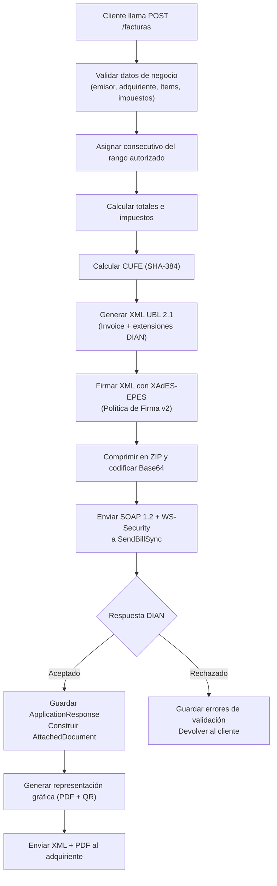

# API de Facturación Electrónica — DIAN Colombia

API propia para **crear, firmar, transmitir y consultar facturas electrónicas de venta** conectándose directamente a los **servicios web de la DIAN** bajo el modelo de **validación previa**, en modo de operación **Software Propio**.

> [!NOTE]
> **Estado:** API funcional en modo **simulado** (sin credenciales DIAN) y lista para el ambiente de
> **habilitación** al configurar certificado, SoftwareID, PIN y TestSetId
> ([guía](docs/03-habilitacion/guia-habilitacion.md)). También puede emitir a través del proveedor
> tecnológico **Factus** (`FACTURACION_MODO=factus`). El ambiente de producción no está soportado a propósito.

## Inicio rápido

```bash
python -m venv .venv && source .venv/bin/activate
pip install -e ".[dev]"
cp .env.example .env                       # cambie JWT_SECRETO
python -m facturacion.cli crear-admin --email admin@example.com --nombre "Admin"
uvicorn facturacion.asgi:app --reload      # interfaz web en http://localhost:8000/app/
                                           # Swagger en http://localhost:8000/docs
pytest --cov                               # pruebas
```

Funcionalidades: login JWT con contraseñas **Argon2id**, emisión de factura (UBL 2.1 + CUFE +
firma XAdES-EPES + envío SOAP a la DIAN), descarga de **PDF** y **XML**, **QR** con la evidencia de
la factura y URL de verificación (`/verificar/{cufe}`), **envío por correo** al adquiriente e
**interfaz web** en `/app/` (login, listado, nueva factura, detalle, descargas, correo, usuarios).

Dos modos de emisión (`FACTURACION_MODO`):

| Modo | Quién numera, firma y transmite | Requisitos |
|---|---|---|
| `directo` (defecto) | Esta API (software propio), con `DIAN_MODO=simulado` o `habilitacion` | Ninguno en simulado |
| `factus` | El proveedor tecnológico **Factus** (API REST v2, sandbox) | Credenciales `FACTUS_*` ([guía](docs/guia/05-factus-sandbox.md)) |

Stack: Python 3.12, FastAPI, SQLAlchemy/Alembic, lxml + signxml, httpx, reportlab, segno;
interfaz en HTML/CSS/JS sin paso de build.
Documentación técnica en [`docs/`](docs/README.md); contexto para agentes de IA en [`.agents/`](.agents/README.md).

## Guía para entender el proyecto

Si es su primera vez con la facturación electrónica o va a sustentar el proyecto, lea la
**[guía de aprendizaje](docs/guia/README.md)**:

1. [Conceptos](docs/guia/01-conceptos.md): DIAN, validación previa, CUFE, UBL 2.1, XAdES, QR, habilitación, Factus.
2. [Recorrido del código](docs/guia/02-recorrido-del-codigo.md): arquitectura y el viaje de una factura, función por función.
3. [Seguridad explicada](docs/guia/03-seguridad-explicada.md): cada control y su relación con OWASP Top 10.
4. [Cómo usarlo](docs/guia/04-como-usarlo.md): tutorial práctico y solución de problemas.
5. [Factus sandbox](docs/guia/05-factus-sandbox.md): integración con el proveedor tecnológico.
6. [Preguntas para la sustentación](docs/guia/06-preguntas-para-la-sustentacion.md).

---

## 1. Marco normativo

| Norma / documento | Qué define |
|---|---|
| **Resolución DIAN 000165 de 2023** | Unifica el sistema de facturación, adopta el **Anexo Técnico de Factura Electrónica v1.9**, documentos equivalentes electrónicos (POS) y RADIAN. |
| **Anexo Técnico FE v1.9** | Estructura XML (UBL 2.1), reglas de validación, CUFE/CUDE, catálogos (listas de valores), servicios web. |
| **Política de Firma v2 (DIAN)** | Reglas de la firma XAdES-EPES que debe llevar cada XML. |
| **RADIAN** | Registro de la factura como título valor (eventos: acuse, recibo del bien, aceptación/reclamo). |

Cambios clave del Anexo 1.9 que impactan el diseño:
- La **fecha de emisión, firma y transmisión deben coincidir** (mismo día). No se puede “acumular” y enviar después.
- Los datos del emisor deben coincidir **exactamente con el RUT**; si no, rechazo automático.
- Notas crédito/débito: motivos específicos (se eliminó “Otros”); fecha de la factura original obligatoria.
- Nuevos tipos de identificación (p. ej. **PPT**) e impuestos saludables (Ley 2277 de 2022).

---

## 2. Actores y requisitos previos

| Requisito | Dónde se obtiene |
|---|---|
| RUT actualizado con responsabilidad de facturador electrónico | DIAN / MUISCA |
| **Certificado de firma digital** (.p12/.pfx) de una entidad acreditada por ONAC | Certicámara, GSE, Andes SCD, etc. |
| Registro como **Software Propio** → `SoftwareID`, **PIN** y **TestSetId** | Portal de Habilitación DIAN |
| **Resolución de numeración** (prefijo, rango, vigencia) y **Clave Técnica** | MUISCA → asociar en portal de FE |

---

## 3. Flujo completo de una factura



---

## 4. Servicios web de la DIAN

**Endpoints (WCF / SOAP 1.2):**

| Ambiente | URL |
|---|---|
| Habilitación (pruebas) | `https://vpfe-hab.dian.gov.co/WcfDianCustomerServices.svc?wsdl` |
| Producción | `https://vpfe.dian.gov.co/WcfDianCustomerServices.svc?wsdl` |

**Métodos principales:**

| Método | Uso | Ambiente |
|---|---|---|
| `SendTestSetAsync` | Envía documentos del **set de pruebas** usando el `testSetId`. Devuelve un `TrackId`. | Habilitación |
| `SendBillSync` | Envía un documento y recibe la validación **inmediata**. | Ambos (principal en producción) |
| `SendBillAsync` | Envío asíncrono; devuelve `TrackId`. | Ambos |
| `GetStatusZip` | Consulta el resultado de un envío asíncrono por `TrackId`. | Ambos |
| `GetStatus` | Consulta el estado de un documento por CUFE/CUDE. | Ambos |
| `GetNumberingRange` | Consulta rangos de numeración autorizados y la **clave técnica**. | Ambos |
| `GetXmlByDocumentKey` | Descarga el XML validado por CUFE/CUDE. | Ambos |
| `SendEventUpdateStatus` | Registra eventos RADIAN (`ApplicationResponse`). | Ambos |

**Requisitos del mensaje SOAP:**
- **SOAP 1.2** con encabezados **WS-Addressing** (`wsa:Action` con la acción del método, `wsa:To` con la URL del servicio).
- Encabezado **WS-Security**: `wsse:BinarySecurityToken` con el certificado, `wsu:Timestamp` y firma del encabezado.
- El documento viaja como **ZIP → Base64** en el parámetro `contentFile` (más `fileName`, y `testSetId` solo en habilitación).

---

## 5. Piezas técnicas clave

### 5.1 XML UBL 2.1
- Documentos: `Invoice` (factura), `CreditNote`, `DebitNote`, `ApplicationResponse` (respuesta/eventos), `AttachedDocument` (contenedor para el adquiriente).
- Extensiones DIAN en `ext:UBLExtensions`:
  - `UBLExtension[1]` → `sts:DianExtensions` (resolución de numeración, `SoftwareID`, `SoftwareSecurityCode`, `QRCode`, etc.).
  - `UBLExtension[2]` → `ds:Signature` (firma).
- Validar contra los **XSD** y las **listas de valores** del anexo (guardar en [`recursos/`](recursos/)).

### 5.2 CUFE (facturas) y CUDE (notas)
Cadena concatenada **sin separadores**, hash **SHA-384**, resultado en hexadecimal minúscula (96 caracteres), va en `cbc:UUID`:

```
CUFE = SHA384( NumFac + FecFac + HorFac + ValFac
             + "01" + ValIVA + "04" + ValINC + "03" + ValICA
             + ValTot + NitOFE + NumAdq + ClaveTecnica + TipoAmbiente )
```

| Campo | Origen |
|---|---|
| `NumFac` | Prefijo + número (`cbc:ID`) |
| `FecFac` / `HorFac` | `cbc:IssueDate` (`AAAA-MM-DD`) / `cbc:IssueTime` (`HH:MM:SS-05:00`) |
| `ValFac` | Subtotal sin impuestos (`LineExtensionAmount`), 2 decimales |
| `01` / `04` / `03` | Códigos de IVA / INC / ICA con su valor (0.00 si no aplica) |
| `ValTot` | Total a pagar (`PayableAmount`) |
| `NitOFE` / `NumAdq` | NIT del emisor (sin DV) / identificación del adquiriente |
| `ClaveTecnica` | De la resolución de numeración |
| `TipoAmbiente` | `1` producción, `2` habilitación |

- **CUDE** (notas crédito/débito): misma idea, pero usa el **PIN del software** en lugar de la clave técnica.
- **SoftwareSecurityCode** = `SHA384(SoftwareID + PIN + NumFac)`.

### 5.3 Firma digital XAdES-EPES
- Firma *enveloped* dentro de `UBLExtension[2]`.
- Incluye `SignedProperties` (hora de firma, certificado firmante) y `SignaturePolicyIdentifier` que apunta a la **Política de Firma v2** de la DIAN con su hash.
- Certificado vigente emitido por entidad acreditada ONAC.

### 5.4 Representación gráfica
- PDF legible para el adquiriente, con **código QR** en todas las páginas.
- El QR incluye datos básicos y la URL de consulta:
  `https://catalogo-vpfe.dian.gov.co/document/searchqr?documentkey={CUFE}`
  (en habilitación: `catalogo-vpfe-hab.dian.gov.co`).

---

## 6. Proceso de habilitación (Software Propio)

1. Portal DIAN → **Factura Electrónica → Habilitación** → ingresar NIT → token al correo del RUT.
2. Configurar modo de operación **Software Propio** → registrar nombre del software y **PIN**.
3. DIAN asigna **SoftwareID**, **TestSetId** y un **rango de numeración de pruebas** (con su clave técnica de pruebas).
4. Enviar el **set de pruebas** con `SendTestSetAsync` (típicamente varias facturas + notas crédito + notas débito) y consultar con `GetStatusZip`.
5. Al completar el set, el estado pasa a **Habilitado**.
6. Solicitar la **resolución de numeración** en MUISCA y **asociar prefijos** al software en producción.
7. Cambiar a endpoints de producción, `TipoAmbiente = 1`, quitar `testSetId` y usar la clave técnica real.

---

## 7. Contrato de la API

Ver [docs/06-contrato-api/endpoints.md](docs/06-contrato-api/endpoints.md). Resumen:
`POST /api/v1/auth/login`, `POST /api/v1/facturas`, `GET /api/v1/facturas/{id}/pdf|xml|qr`,
`POST /api/v1/facturas/{id}/correo`, `GET /api/v1/verificacion/{cufe}` (JSON público) y
`GET /verificar/{cufe}` (página pública, destino del QR). La interfaz web vive en `/app/`.

---

## 8. Estructura del repositorio

```
API-FACTURACION/
├── .agents/                 Contexto persistente para agentes de IA
├── .github/workflows/       CI: lint, tests, migraciones, pip-audit
├── docs/                    Guía de aprendizaje, arquitectura, ADRs, seguridad, contrato API, habilitación
├── migraciones/             Alembic
├── src/facturacion/
│   ├── api/                 Rutas FastAPI, esquemas, errores, middleware
│   ├── dominio/             Factura, totales, CUFE, contenido del QR
│   ├── ubl/                 XML UBL 2.1 + extensiones DIAN, ZIP
│   ├── firma/               XAdES-EPES (Política de Firma v2)
│   ├── dian/                Cliente SOAP 1.2 + WS-Security y cliente simulado
│   ├── proveedor/           Proveedor tecnológico: puerto y cliente REST de Factus
│   ├── representacion/      PDF y QR
│   ├── correo/              SMTP y simulado
│   ├── persistencia/        Modelos y repositorios SQLAlchemy
│   ├── seguridad/           Argon2id, JWT, limitador de intentos
│   ├── servicios/           Caso de uso de emisión
│   ├── web/                 Interfaz web (/app/) y página de verificación (/verificar/{cufe})
│   ├── arranque.py          Composición de adaptadores
│   └── cli.py               crear-admin
├── recursos/                XSD, listas de valores, política de firma (por descargar)
├── certificados/            Certificado .p12 (ignorado por git)
└── tests/                   unitarias/ e integracion/
```

---

## 9. Hoja de ruta

1. ✅ CUFE (verificado con el ejemplo del Anexo), XML UBL, firma XAdES-EPES, cliente SOAP.
2. ✅ API REST con JWT, PDF + QR, correo, verificación pública.
3. ✅ Interfaz web (`/app/`) y modo proveedor tecnológico Factus (`FACTURACION_MODO=factus`; sin probar en vivo).
4. ⬜ Descargar Anexo 1.9, XSD y listas de valores; validar el XML contra los XSD.
5. ⬜ Conectar a habilitación con credenciales reales y superar el set de pruebas; probar Factus sandbox en vivo.
6. ⬜ Notas crédito/débito (CUDE), `AttachedDocument`, eventos RADIAN.
7. ⬜ Producción (nuevo ADR): resolución real, monitoreo, reintentos programados.

---

## 10. Errores comunes a prevenir

- Fecha de emisión distinta a la fecha de envío → rechazo.
- Datos del emisor que no coinciden con el RUT.
- Redondeos: totales e impuestos con 2 decimales consistentes entre XML y cadena del CUFE.
- `TipoAmbiente` o clave técnica del ambiente equivocado.
- Certificado vencido o sin cadena de confianza completa.
- Hora sin zona horaria (`-05:00`).
- Olvidar quitar `testSetId` al pasar a producción.

---

## 11. Referencias

- DIAN – Factura electrónica: https://www.dian.gov.co/impuestos/factura-electronica
- Documentación técnica (Anexo, XSD, Política de Firma): https://www.dian.gov.co/impuestos/factura-electronica/documentacion
- Resolución 000165 de 2023 (DIAN).
- Catálogo de consulta: https://catalogo-vpfe.dian.gov.co
