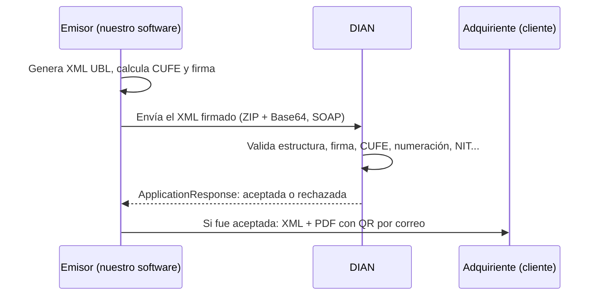

# 1. Conceptos: la factura electrónica en Colombia desde cero

> Objetivo: que entienda **qué problema resuelve** el software antes de mirar una sola línea
> de código. Al final hay un [glosario](#glosario).

## 1.1 ¿Qué es una factura electrónica?

Una factura es el documento que prueba una venta: quién vende (**emisor** o *facturador*),
quién compra (**adquiriente**), qué se vendió, cuánto cuesta y cuánto impuesto se cobró.

En Colombia la factura **electrónica** no es "un PDF enviado por correo". Es un **archivo XML**
con una estructura definida por la DIAN, **firmado digitalmente** por el emisor y **validado
por la DIAN** antes de entregarse al comprador. El PDF es solo una *representación gráfica*
para que las personas la lean.

| Papel / PDF tradicional | Factura electrónica de venta |
|---|---|
| El documento válido es el papel o el PDF | El documento válido es el **XML firmado y validado** |
| Cualquiera puede editarlo | La firma digital detecta cualquier cambio |
| La DIAN se entera meses después | La DIAN la valida **antes** de entregarse (validación previa) |
| Numeración controlada por la empresa | Numeración autorizada por una **resolución** de la DIAN |

## 1.2 La DIAN y la validación previa

La **DIAN** (Dirección de Impuestos y Aduanas Nacionales) es la autoridad tributaria. Opera
servicios web donde se envían las facturas. En el modelo de **validación previa**:



Si la DIAN la **rechaza**, la factura no existe para efectos tributarios. Por eso el
software guarda el estado de cada factura (`aceptada`, `rechazada`, `en_proceso`, `error_envio`;
ver `src/facturacion/persistencia/modelos.py`, clase `EstadoFactura`).

Marco normativo actual (ver la sección 1 del [README](../../README.md)): la **Resolución DIAN
000165 de 2023** y su **Anexo Técnico de Factura Electrónica v1.9**, que define el XML, las
reglas de validación, el CUFE y los servicios web.

## 1.3 UBL 2.1: el formato del XML

**UBL** (*Universal Business Language*) es un estándar internacional de OASIS para documentos
de negocio (facturas, órdenes de compra…). La DIAN adoptó **UBL 2.1** y le agregó extensiones
propias (`sts:DianExtensions`) con la resolución de numeración, el `SoftwareID`, el QR, etc.

Esqueleto simplificado de lo que genera `src/facturacion/ubl/generador.py`:

```xml
<Invoice xmlns="urn:oasis:names:specification:ubl:schema:xsd:Invoice-2" ...>
  <ext:UBLExtensions>
    <ext:UBLExtension>  <!-- [1] sts:DianExtensions: resolución, SoftwareID, QR -->
    <ext:UBLExtension>  <!-- [2] aquí va la firma ds:Signature (XAdES) -->
  </ext:UBLExtensions>
  <cbc:UBLVersionID>UBL 2.1</cbc:UBLVersionID>
  <cbc:ProfileExecutionID>2</cbc:ProfileExecutionID>   <!-- 2 = pruebas -->
  <cbc:ID>SETP990000000</cbc:ID>                        <!-- prefijo + número -->
  <cbc:UUID schemeName="CUFE-SHA384">…96 hex…</cbc:UUID> <!-- el CUFE -->
  <cbc:IssueDate>…</cbc:IssueDate>
  … emisor (AccountingSupplierParty), adquiriente (AccountingCustomerParty),
    impuestos (TaxTotal), totales (LegalMonetaryTotal), líneas (InvoiceLine) …
</Invoice>
```

El orden de los elementos importa: el XSD de UBL es estricto con la secuencia.

## 1.4 El CUFE: la "huella" de la factura

**CUFE** = *Código Único de Factura Electrónica*. Es un **hash SHA-384** (96 caracteres
hexadecimales) calculado sobre los datos esenciales de la factura más una **clave técnica**
secreta que la DIAN entrega con la resolución de numeración.

```
CUFE = SHA384( NumFac + FecFac + HorFac + ValFac
             + "01" + ValIVA + "04" + ValINC + "03" + ValICA
             + ValTot + NitOFE + NumAdq + ClaveTecnica + TipoAmbiente )
```

Implementación real (`src/facturacion/dominio/cufe.py`, función `cadena_cufe`):

```python
return "".join((
    factura.numeracion.numero_completo,
    factura.fecha_emision.isoformat(),
    formatear_hora(factura),            # HH:MM:SS-05:00
    _monto(totales.subtotal),
    CODIGO_IVA, _monto(totales.total_iva),
    CODIGO_INC, _monto(totales.total_inc),
    CODIGO_ICA, _monto(totales.total_ica),
    _monto(totales.total_a_pagar),
    factura.emisor.nit,
    factura.adquiriente.numero_documento,
    clave_tecnica,
    tipo_ambiente,
))
```

¿Por qué sirve?

- **Identifica** la factura de forma única (va en `cbc:UUID` y en el QR).
- **Amarra los valores**: si alguien cambia el total, el CUFE ya no coincide.
- La clave técnica impide que un tercero fabrique CUFE válidos para otro emisor.

El cálculo está probado contra el **ejemplo oficial del Anexo Técnico** en
`tests/unitarias/test_dominio.py::test_cufe_coincide_con_el_ejemplo_del_anexo_tecnico`.

Primos del CUFE: el **CUDE** (para notas crédito/débito, usa el PIN del software; aún no
implementado) y el **SoftwareSecurityCode** = `SHA384(SoftwareID + PIN + NumFac)`, que sí se
calcula (`calcular_software_security_code`).

## 1.5 Firma digital XAdES-EPES

Una **firma digital** usa criptografía de llave pública: el emisor firma con su **llave
privada** y cualquiera verifica con el **certificado** (llave pública). Si un solo byte del XML
cambia, la verificación falla. Así se garantiza **integridad** y **no repudio**.

- **XML-DSig** es el estándar W3C para firmar XML (`ds:Signature`).
- **XAdES** (*XML Advanced Electronic Signatures*, ETSI) le agrega propiedades firmadas: hora
  de firma, certificado del firmante, rol.
- **EPES** (*Explicit Policy-based Electronic Signature*) significa que la firma declara la
  **política de firma** que cumple: aquí, la *Política de Firma v2 de la DIAN* con su hash.

En el proyecto: `src/facturacion/firma/xades.py`, clase `FirmadorXades`, método `firmar`. La
firma es *enveloped* (queda dentro del propio documento, en `UBLExtension[2]`), con RSA-SHA256.

El certificado real debe emitirlo una entidad acreditada por **ONAC** (Certicámara, GSE,
Andes SCD…). En modo simulado se genera un **certificado autofirmado en memoria**
(`FirmadorXades.autofirmado_para_desarrollo`), que la DIAN real no aceptaría.

## 1.6 Envío a la DIAN: SOAP, ZIP y WS-Security

La DIAN no usa REST sino **SOAP 1.2** (servicio WCF). El XML firmado se comprime en **ZIP**, se
codifica en **Base64** y viaja en un sobre SOAP que, además, va **firmado con WS-Security**
(el mismo certificado firma el encabezado `wsa:To`). Métodos usados por el proyecto
(`src/facturacion/dian/soap.py`):

| Método DIAN | Para qué | Función del proyecto |
|---|---|---|
| `SendBillSync` | Envío con validación inmediata | `ClienteDianSoap.enviar_factura` |
| `SendTestSetAsync` | Envío dentro del set de pruebas (devuelve `TrackId`) | `ClienteDianSoap.enviar_set_pruebas` |
| `GetStatusZip` | Consultar el resultado de un envío asíncrono | `ClienteDianSoap.consultar_estado_zip` |

La DIAN responde con un **ApplicationResponse**: un XML firmado por la DIAN que dice si el
documento fue validado.

## 1.7 El código QR y la representación gráfica

La **representación gráfica** es el PDF que ve el cliente. Debe incluir un **código QR** con
datos básicos de la factura y una URL de consulta. Contenido real que arma
`dominio/cufe.py:contenido_qr`:

```
NumFac=SETP990000000
FecFac=2026-10-20
HorFac=10:15:00-05:00
NitFac=900000000
DocAdq=1020304050
ValFac=480000.00
ValIva=91200.00
ValOtroIm=0.00
ValTolFac=571200.00
CUFE=…96 hex…
QRCode=http://localhost:8000/verificar/…cufe…
```

La URL del QR depende de la configuración (`QR_URL_MODO` y `FACTURACION_MODO`):

| Caso | URL dentro del QR |
|---|---|
| `QR_URL_MODO=propia` (por defecto) | `{URL_PUBLICA_BASE}/verificar/{cufe}`: página HTML pública de **este** sistema, que consulta `GET /api/v1/verificacion/{cufe}` |
| `QR_URL_MODO=dian` | Catálogo de habilitación de la DIAN: `https://catalogo-vpfe-hab.dian.gov.co/document/searchqr?documentkey={cufe}` |
| `FACTURACION_MODO=factus` | La URL que devuelve Factus (consulta en el catálogo DIAN) |

El PDF (`src/facturacion/representacion/pdf.py`) siempre lleva la franja
**"AMBIENTE DE PRUEBAS / HABILITACIÓN - SIN VALIDEZ TRIBUTARIA"** y, si la factura no está
aceptada, un sello de agua "SIN VALIDEZ".

## 1.8 Numeración autorizada y consecutivos

El emisor no puede inventar números: la DIAN le autoriza un **rango** (p. ej. `SETP` del
990000000 al 995000000) con fechas de vigencia y una clave técnica. Las facturas deben ser
**consecutivas** dentro del rango. En el proyecto esos datos son las variables
`NUMERACION_*` y el consecutivo se reserva de forma atómica en la tabla `consecutivos`
(ver [guía 2](02-recorrido-del-codigo.md#28-base-de-datos)).

## 1.9 Habilitación: el ambiente de pruebas de la DIAN

Antes de facturar "de verdad", un software debe **habilitarse**:

1. El emisor (con RUT de facturador electrónico) entra al portal de habilitación.
2. Registra su software como **Software propio** y define un **PIN**.
3. La DIAN le da un **SoftwareID**, un **TestSetId** y un rango de pruebas.
4. Envía el **set de pruebas** (facturas y notas) a `vpfe-hab.dian.gov.co`.
5. Cuando el set se acepta, el software queda **habilitado** y puede pasar a producción.

Este proyecto soporta `DIAN_MODO=simulado` (sin red, valida estructura, firma y CUFE en
local con `dian/simulado.py`) y `DIAN_MODO=habilitacion`. **Producción no está soportada a
propósito** ([ADR-003](../decisions/ADR-003-integracion-dian.md)): `tipo_ambiente_dian` siempre
devuelve `"2"`. Detalle de credenciales:
[paso a paso](../03-habilitacion/paso-a-paso-credenciales.md).

## 1.10 Software propio vs. proveedor tecnológico (Factus)

La DIAN permite varios **modos de operación**. Los dos que implementa el proyecto:

| | Software propio (`FACTURACION_MODO=directo`) | Proveedor tecnológico (`FACTURACION_MODO=factus`) |
|---|---|---|
| Quién genera el XML y lo firma | Nuestra API | El proveedor (Factus) |
| Certificado de firma | Lo compra el emisor | Lo pone el proveedor |
| Quién asigna número y CUFE | Nuestra API (`NUMERACION_*`) | El proveedor |
| Quién habla con la DIAN | Nuestra API (SOAP) | El proveedor |
| Requisitos | RUT, certificado ONAC, superar set de pruebas | Cuenta con el proveedor (sandbox gratis) |
| Qué sigue haciendo nuestra API | Todo | Validar entrada, calcular totales, guardar, PDF, QR, correo, verificación |

Un **proveedor tecnológico** es una empresa autorizada por la DIAN para facturar en nombre de
otros. **Factus** ofrece una API REST con un ambiente *sandbox*. Detalles en la
[guía 5](05-factus-sandbox.md) y en [ADR-004](../decisions/ADR-004-proveedor-tecnologico-factus.md).

¿Por qué tener ambos? El modo directo muestra **cómo funciona todo por dentro** (valor
académico); el modo Factus permite **probar con un sistema real** sin certificado ni RUT.

## 1.11 Lo que el proyecto todavía no hace

Para no sobrevender en la sustentación (fuente: `.agents/tasks/pendientes.md` y
[guía de habilitación](../03-habilitacion/guia-habilitacion.md)):

- Notas crédito/débito (CUDE) y eventos RADIAN.
- `AttachedDocument` para el correo (hoy se adjuntan el XML firmado y el `ApplicationResponse` sueltos en un ZIP).
- Validación del XML contra los XSD oficiales.
- Impuestos distintos del IVA 0/5/19 % (INC e ICA van en 0.00).
- Nunca se ha probado contra la DIAN real ni contra Factus en vivo.

## Glosario

| Término | Significado |
|---|---|
| **Adquiriente** | El comprador que recibe la factura. |
| **Anexo Técnico** | Documento de la DIAN (v1.9) con la especificación del XML, validaciones y servicios. |
| **ApplicationResponse** | XML de respuesta de la DIAN que dice si el documento fue validado. |
| **AttachedDocument** | Contenedor XML que el anexo pide enviar al adquiriente (pendiente). |
| **Base64** | Codificación de bytes en texto; así viaja el ZIP en el sobre SOAP. |
| **CUFE** | Código Único de Factura Electrónica: SHA-384 de los datos clave + clave técnica. |
| **CUDE** | Equivalente del CUFE para notas crédito/débito (usa el PIN). |
| **Clave técnica** | Secreto asociado a la resolución de numeración; entra en el CUFE. |
| **DANE (código)** | Código del municipio (5 dígitos, p. ej. Bogotá `11001`). |
| **DIAN** | Dirección de Impuestos y Aduanas Nacionales. |
| **DV** | Dígito de verificación del NIT. |
| **Emisor / facturador** | Quien vende y emite la factura (variables `EMISOR_*`). |
| **Habilitación** | Ambiente y proceso de pruebas de la DIAN (`vpfe-hab.dian.gov.co`). |
| **NIT** | Número de Identificación Tributaria (tipo de documento `31`). |
| **ONAC** | Organismo que acredita a las entidades que emiten certificados digitales. |
| **PIN del software** | Número que el emisor define al registrar su software propio. |
| **Proveedor tecnológico** | Empresa autorizada que factura en nombre de otros (p. ej. Factus). |
| **QR** | Código bidimensional en el PDF con datos de la factura y URL de consulta. |
| **RADIAN** | Registro de la factura electrónica como título valor (eventos de aceptación, etc.). |
| **Representación gráfica** | El PDF legible por personas. |
| **Resolución de numeración** | Autorización de la DIAN de un rango de números con prefijo y vigencia. |
| **RUT** | Registro Único Tributario; los datos del emisor deben coincidir con él. |
| **Set de pruebas** | Conjunto de documentos que se envían para quedar habilitado (`TestSetId`). |
| **SOAP / WCF** | Protocolo de servicios web basado en XML que usa la DIAN. |
| **SoftwareID** | Identificador del software asignado por la DIAN. |
| **SoftwareSecurityCode** | `SHA384(SoftwareID + PIN + número)`; va en las extensiones DIAN. |
| **TipoAmbiente** | `1` producción, `2` pruebas. El proyecto usa siempre `2`. |
| **TrackId** | Identificador de un envío asíncrono para consultarlo con `GetStatusZip`. |
| **UBL 2.1** | Estándar XML de OASIS para documentos de negocio, adoptado por la DIAN. |
| **WS-Security** | Estándar para firmar/proteger mensajes SOAP. |
| **XAdES-EPES** | Firma XML avanzada con política explícita (Política de Firma DIAN v2). |
| **XSD** | Esquema que define qué estructura XML es válida. |
