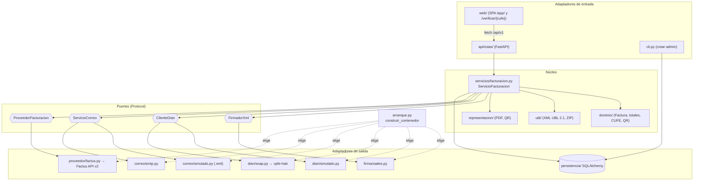
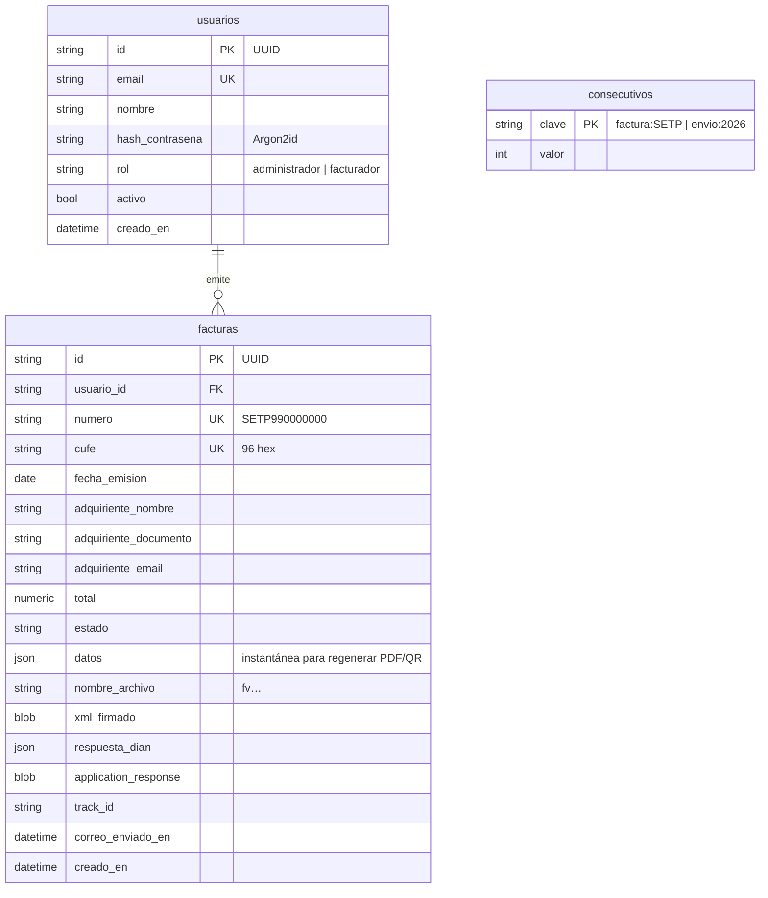

# 2. Recorrido del código

> Objetivo: saber **dónde está cada cosa** y poder seguir una petición de principio a fin,
> nombrando archivo y función. Todas las rutas son relativas a `src/facturacion/`.

## 2.1 Arquitectura: monolito modular hexagonal

El proyecto es **un solo servicio** (monolito) dividido en paquetes con responsabilidades
claras, siguiendo **puertos y adaptadores** (arquitectura hexagonal):

- El **dominio** (`dominio/`, `ubl/`) es código puro: no sabe nada de HTTP, base de datos ni red.
- Lo que habla con el mundo exterior (DIAN, firma, correo, Factus) se define como un
  **puerto**: un `Protocol` de Python en `*/puertos.py`.
- Cada puerto tiene **adaptadores** intercambiables (real y simulado).
- **`arranque.py`** es el único lugar que decide qué adaptador usar según la configuración
  (*composition root*).



Ventaja práctica: pasar de simulado a habilitación, de correo `.eml` a Gmail, o de modo
directo a Factus es **solo configuración**; y los tests reemplazan adaptadores por falsos
sin tocar el núcleo (p. ej. `ProveedorFalso` en `tests/integracion/test_modo_proveedor.py`).

## 2.2 Mapa de paquetes

| Paquete / archivo | Qué hace | Piezas clave |
|---|---|---|
| `main.py` | Fábrica de la app FastAPI: Swagger (solo fuera de producción), manejadores de error, middleware, CORS, routers | `crear_app` |
| `asgi.py` | Objeto `app` para `uvicorn facturacion.asgi:app` | `app` |
| `configuracion.py` | Lee y valida variables de entorno (pydantic-settings, 12-factor) | `Configuracion`, `ModoDian`, `ModoFacturacion`, `ModoCorreo`, `ModoUrlQr` |
| `arranque.py` | Raíz de composición: crea BD, firmador, cliente DIAN, correo y proveedor | `construir_contenedor`, `_cliente_dian`, `_proveedor`, `ConfiguracionIncompleta` |
| `cli.py` | Crear el primer administrador por consola | `crear_admin`, `main` |
| `api/dependencias.py` | Inyección de dependencias: sesión BD, usuario autenticado, roles | `Contenedor`, `usuario_actual`, `requerir_rol` |
| `api/esquemas.py` | Esquemas Pydantic de entrada (estrictos, sin caracteres de control) y salida | `EsquemaEntrada` (`extra="forbid"`), `SIN_CONTROL`, `FacturaEntrada`, `FacturaDetalle`, `VerificacionPublica` |
| `api/errores.py` | Traduce excepciones a HTTP con forma `{"detalle": ...}` | `registrar_manejadores` |
| `api/middleware.py` | Cabeceras de seguridad, CSP, límite de 1 MiB (también para cuerpos *chunked*) | `LimiteCuerpo` (ASGI puro), `registrar_middleware`, `_CSP_API`, `_CSP_WEB` |
| `api/rutas/autenticacion.py` | Login, registro, perfil | `iniciar_sesion`, `registrar_usuario`, `perfil` |
| `api/rutas/facturas.py` | Emitir, listar, detalle, PDF/XML/QR, correo, reintentos | `emitir_factura`, `_cargar` (anti-IDOR), `_detalle` |
| `api/rutas/publico.py` | `/salud` y verificación pública por CUFE | `verificar_factura` |
| `web/rutas.py` | Sirve la SPA estática y la página de verificación | `raiz`, `archivos_app`, `pagina_verificacion` |
| `web/static/` | HTML, CSS y JS (módulos ES, sin build) | `js/app.js` (router por hash), `js/api.js`, `js/verificar.js` |
| `servicios/facturacion.py` | **Caso de uso**: orquesta la emisión y los derivados | `ServicioFacturacion.emitir`, `_emitir_con_proveedor`, `_transmitir`, `pdf`, `qr_png`, `enviar_correo` |
| `servicios/serializacion.py` | Factura ↔ instantánea JSON guardada en la BD | `factura_a_json`, `factura_desde_json` |
| `dominio/factura.py` | Modelo puro: `Emisor`, `Adquiriente`, `LineaFactura`, `Numeracion`, `Factura`, totales con `Decimal` | `calcular_totales`, `redondear` (ROUND_HALF_UP) |
| `dominio/cufe.py` | CUFE, SoftwareSecurityCode, texto del QR | `calcular_cufe`, `contenido_qr`, `formatear_hora` |
| `ubl/generador.py` | XML UBL 2.1 con `DianExtensions` | `generar_xml_factura`, `DatosSoftware` |
| `ubl/empaquetado.py` | Nombre de archivo DIAN y ZIP | `nombre_base`, `empaquetar_zip` |
| `firma/` | Puerto `FirmadorXml` y XAdES-EPES | `FirmadorXades.firmar`, `desde_pkcs12`, `autofirmado_para_desarrollo` |
| `dian/` | Puerto `ClienteDian`; adaptadores simulado y SOAP | `ClienteDianSimulado`, `ClienteDianSoap`, `construir_sobre` |
| `proveedor/` | Puerto `ProveedorFacturacion`; adaptador Factus | `ClienteFactus`, `construir_payload`, `interpretar_validacion` |
| `representacion/` | PDF (reportlab) y QR (segno) | `generar_pdf`, `generar_qr_png` |
| `correo/` | Puerto `ServicioCorreo`; SMTP y simulado | `construir_mensaje`, `ServicioCorreoSmtp`, `ServicioCorreoSimulado` |
| `persistencia/` | Modelos ORM y consultas | `Usuario`, `Consecutivo`, `FacturaRegistro`, `siguiente_consecutivo` |
| `seguridad/` | Argon2id, JWT, limitador de intentos (por IP + correo y por IP) | `contrasenas.py`, `tokens.py`, `limitador.py` |

## 2.3 Cómo arranca la aplicación

1. `uvicorn facturacion.asgi:app` importa `asgi.py`, que llama `main.py:crear_app()`.
2. `crear_app` lee `configuracion.py:obtener_configuracion()` (variables de entorno y `.env`).
   Si algo es incoherente (p. ej. `JWT_SECRETO` de menos de 32 caracteres) **no arranca**.
3. `arranque.py:construir_contenedor` crea el motor de BD (y las tablas si no es producción),
   y elige adaptadores:

```python
# arranque.py
def _proveedor(config: Configuracion) -> ProveedorFacturacion | None:
    if config.facturacion_modo is ModoFacturacion.DIRECTO:
        return None
    faltantes = config.faltantes_para_factus()
    if faltantes:
        raise ConfiguracionIncompleta(f"Faltan variables para Factus: {', '.join(faltantes)}")
    return ClienteFactus(...)
```

| Variable | Valor | Adaptador elegido |
|---|---|---|
| `DIAN_MODO` | `simulado` (defecto) | `ClienteDianSimulado` |
| | `habilitacion` | `ClienteDianSoap` (exige SoftwareID, PIN, certificado) |
| `CORREO_MODO` | `simulado` (defecto) | `ServicioCorreoSimulado` → `var/correos/*.eml` |
| | `smtp` | `ServicioCorreoSmtp` |
| `FACTURACION_MODO` | `directo` (defecto) | sin proveedor (firma y DIAN propios) |
| | `factus` | `ClienteFactus` (exige `FACTUS_CLIENT_ID`, `FACTUS_CLIENT_SECRET`, `FACTUS_USUARIO`, `FACTUS_CLAVE`) |
| `DIAN_CERTIFICADO_RUTA` | vacío | certificado autofirmado en memoria (solo simulado) |

4. Todo queda en un `Contenedor` (`api/dependencias.py`) guardado en `app.state.contenedor`,
   que las rutas reciben con `ContenedorDep`.

## 2.4 Sigamos una petición: `POST /api/v1/facturas` en modo `directo`

```mermaid
sequenceDiagram
    autonumber
    actor U as Usuario (SPA o curl)
    participant MW as api/middleware.py<br/>LimiteCuerpo + _seguridad
    participant DEP as api/dependencias.py
    participant R as api/rutas/facturas.py<br/>emitir_factura
    participant S as servicios/facturacion.py<br/>ServicioFacturacion
    participant REP as persistencia/repositorios.py
    participant DOM as dominio/
    participant UBL as ubl/generador.py
    participant F as firma/xades.py
    participant D as ClienteDian<br/>(simulado o soap)
    participant BD as Base de datos

    U->>MW: POST /api/v1/facturas (Bearer JWT, JSON)
    MW->>MW: LimiteCuerpo: cuerpo > 1 MiB (Content-Length o bytes contados)? → 413
    MW->>DEP: usuario_actual()
    DEP->>DEP: seguridad/tokens.py:validar_token (HS256, iss, aud, exp…)
    DEP->>BD: sesion.get(Usuario) → activo? (rol desde BD)
    MW->>R: FacturaEntrada validada por Pydantic (si no, 422)
    R->>S: emitir(sesion, usuario, SolicitudFactura)
    S->>S: ¿resolución vigente? (NUMERACION_FECHA_*)
    S->>REP: siguiente_consecutivo("factura:SETP") (UPDATE … RETURNING)
    REP-->>S: 990000000
    S->>DOM: Factura(...) → calcular_totales (Decimal, ROUND_HALF_UP)
    S->>DOM: cufe.py:calcular_cufe(factura, clave_tecnica, "2")
    S->>DOM: calcular_software_security_code + contenido_qr
    S->>UBL: generar_xml_factura(factura, DatosSoftware)
    UBL-->>S: XML con UBLExtension[2] vacío
    S->>F: FirmadorXades.firmar(xml)
    F-->>S: XML firmado XAdES-EPES
    S->>REP: siguiente_consecutivo("envio:2026") → ubl/empaquetado.py:nombre_base
    S->>BD: sesion.add(FacturaRegistro estado=error_envio); commit()
    Note over S,BD: commit ANTES de llamar a la DIAN: libera el bloqueo del consecutivo
    S->>S: _transmitir(registro): empaquetar_zip
    alt DIAN_TEST_SET_ID definido
        S->>D: enviar_set_pruebas(zip) (SendTestSetAsync)
    else
        S->>D: enviar_factura(zip) (SendBillSync)
    end
    alt Respuesta recibida
        D-->>S: RespuestaDian (+ ApplicationResponse)
        S->>S: _aplicar_respuesta → aceptada / rechazada / en_proceso
    else ErrorDian (caída, timeout)
        S->>S: estado = error_envio (reintentable)
    end
    S->>BD: commit() (estado y respuesta DIAN actualizados)
    S-->>R: FacturaRegistro
    R->>R: _detalle(): url_verificacion + enlaces pdf/xml/qr/correo
    R-->>U: 201 Created + FacturaDetalle (JSON)
    MW->>MW: añade cabeceras (CSP, nosniff, no-store…)
```

Puntos finos para la sustentación:

- **El total lo calcula el servidor**, nunca se recibe del cliente (`dominio/factura.py:calcular_totales`).
- **El consecutivo se reserva dentro de la misma transacción** que guarda la factura. Si algo
  falla antes del primer `commit` (p. ej. error de firma), `api/dependencias.py:obtener_sesion`
  hace `rollback` y el número **no se consume**.
- **Dos `commit`:** la factura se guarda primero en `error_envio` (con el XML firmado) y solo
  después se llama a la DIAN. Así el bloqueo de la fila del consecutivo no se mantiene durante
  una llamada de red que puede tardar hasta 60 s, y si el proceso se cae a mitad del envío la
  factura queda guardada para reintentar. Con la respuesta se actualiza el estado y se hace el
  segundo `commit`.
- **Si la DIAN no responde**, la factura queda en `error_envio` con el número ya usado; se
  reintenta con `POST /api/v1/facturas/{id}/reintentar-envio` (`ServicioFacturacion.reintentar_envio`).
  Riesgo conocido: si la DIAN sí recibió el primer envío (timeout tras procesarlo), el
  reenvío puede responder "documento procesado anteriormente"; falta consultar `GetStatus`
  por CUFE antes de reenviar.
- Con `DIAN_TEST_SET_ID` la respuesta es asíncrona: queda `en_proceso` y se consulta con
  `POST /api/v1/facturas/{id}/consultar-estado` (`actualizar_estado` → `GetStatusZip`).
- En modo simulado `dian/simulado.py` revisa de verdad el ZIP: un solo `.xml`, bien formado,
  con `ds:Signature` y CUFE de 96 hex; si no, responde rechazo con código `99`.

### Qué pasa dentro de `ClienteDianSoap` (modo `habilitacion`)

`dian/soap.py:ClienteDianSoap._llamar` arma el sobre con `construir_sobre` (SOAP 1.2 +
WS-Addressing + `wsse:Security` con `BinarySecurityToken`, `Timestamp` y firma RSA-SHA256
sobre `wsa:To`), lo envía con `httpx` (TLS verificado) e interpreta la respuesta con
`interpretar_send_bill_sync` / `interpretar_send_test_set_async` / `interpretar_get_status_zip`.
Cualquier HTTP distinto de 200 o error de red se convierte en `ErrorDian`.

## 2.5 La misma petición en modo `factus`

`ServicioFacturacion.emitir` empieza preguntando si hay proveedor:

```python
def emitir(self, sesion, usuario, solicitud):
    if self._proveedor is not None:
        return self._emitir_con_proveedor(sesion, usuario, solicitud, self._proveedor)
    ...
```

```mermaid
sequenceDiagram
    autonumber
    actor U as Usuario
    participant R as api/rutas/facturas.py<br/>emitir_factura
    participant S as ServicioFacturacion<br/>_emitir_con_proveedor
    participant C as proveedor/factus.py<br/>ClienteFactus
    participant FX as Factus API (sandbox)
    participant BD as Base de datos

    U->>R: POST /api/v1/facturas (JWT + JSON)
    R->>S: emitir(...) → hay proveedor
    S->>S: Factura(...) con Numeracion vacía; totales calculados
    S->>S: referencia = "API-" + uuid4[:24] (reference_code único)
    S->>BD: registro pendiente: estado=en_proceso, numero="PEND-…", cufe="pendiente-…",<br/>datos.proveedor.referencia; commit()
    S->>C: emitir(factura, referencia)
    C->>C: construir_payload() (códigos DIAN/DANE, IVA por ítem)
    C->>C: _token_vigente(): ¿token en memoria vigente?
    opt Sin token o vencido
        C->>FX: POST /oauth/token (refresh_token o password grant)
        FX-->>C: access_token, refresh_token, expires_in
    end
    C->>FX: POST /v2/bills/validate (Bearer)
    alt 401
        C->>FX: login de nuevo y un único reintento
    end
    alt 200/201 validada
        FX-->>C: data.number, data.cufe, data.numbering_range, data.links.qr
        C->>C: interpretar_validacion() → ResultadoEmision
        C->>FX: GET /v2/bills/{numero}/download-xml (mejor esfuerzo)
        FX-->>C: xml_base_64_encoded
        C-->>S: ResultadoEmision(numeracion, cufe, url_qr, xml)
        S->>BD: actualiza el pendiente: numero, cufe, estado=aceptada, datos.url_qr; commit
        alt commit OK
            R-->>U: 201 + FacturaDetalle
        else IntegrityError (número o CUFE ya existen)
            S->>BD: rollback; pendiente → error_envio con numero/cufe del proveedor; commit
            S-->>U: 422 (ErrorNegocio: "quedó registrada para conciliación")
        end
    else 400/409/422 o rechazo DIAN
        C-->>S: RechazoProveedor(mensajes)
        S->>BD: borra el pendiente; commit
        S-->>U: 422 {"detalle":[{"campo":"proveedor","mensaje":...}]}
    else 5xx, timeout, red, JSON/CUFE inválido
        C-->>S: ErrorProveedor
        S->>BD: pendiente → error_envio, "concilie con la referencia API-…"; commit
        S-->>U: 502 "El proveedor de facturación no está disponible"
    end
```

Diferencias clave con el modo directo:

| | `directo` | `factus` |
|---|---|---|
| Número y CUFE | `repositorios.siguiente_consecutivo` + `calcular_cufe` | Los devuelve Factus (`data.number`, `data.cufe`) |
| XML firmado | `FirmadorXades.firmar` | Descargado de Factus; si falla queda vacío y `GET .../xml` responde 404 |
| Antes de la llamada externa | Factura completa en `error_envio` | Registro **pendiente** `en_proceso` con número `PEND-…` y la `referencia` |
| Rechazo | Se guarda `rechazada` (número consumido) | Se **borra** el pendiente (no se emitió nada) → 422 |
| Fallo de comunicación | `error_envio`; `reintentar-envio` reenvía | `error_envio` con la referencia para **conciliar** en el portal de Factus → 502; `reintentar-envio` responde **409** (reenviar podría duplicar) |
| Éxito | `aceptada` (o `en_proceso` en el set de pruebas) | `aceptada` con número y CUFE de Factus |
| URL del QR | `/verificar/{cufe}` o catálogo DIAN | `data.links.qr` de Factus (guardada en `datos["url_qr"]`) |

Más detalle de la integración en la [guía 5](05-factus-sandbox.md).

## 2.6 Los derivados: PDF, QR y correo

Nada de esto se guarda como archivo: se **regenera bajo demanda** desde la instantánea JSON
(`FacturaRegistro.datos`), que incluye emisor y numeración vigentes al emitir.

```mermaid
flowchart LR
    REG[(FacturaRegistro.datos<br/>JSON)] -->|serializacion.py:factura_desde_json| FACT[Factura de dominio]
    FACT -->|cufe.py:contenido_qr + url_registro| TXT[Texto del QR]
    TXT -->|representacion/qr.py:generar_qr_png| PNG[QR PNG]
    FACT --> PDF[representacion/pdf.py:generar_pdf]
    PNG --> PDF
    PDF --> ZIP[_zip_adquiriente:<br/>PDF + XML + ApplicationResponse]
    ZIP -->|correo/mensaje.py:construir_mensaje| MAIL[ServicioCorreo.enviar]
```



| Endpoint | Método del servicio | Qué produce |
|---|---|---|
| `GET /api/v1/facturas/{id}/pdf` | `ServicioFacturacion.pdf` | PDF A4 con QR en cada página, leyenda de ambiente de pruebas y sello "SIN VALIDEZ" si no está aceptada |
| `GET /api/v1/facturas/{id}/qr` | `ServicioFacturacion.qr_png` | PNG (segno, corrección de errores "M") |
| `GET /api/v1/facturas/{id}/xml` | (directo en la ruta) | `xml_firmado` tal como se guardó (404 si está vacío) |
| `POST /api/v1/facturas/{id}/correo` | `ServicioFacturacion.enviar_correo` | Correo con un ZIP; solo si la factura está `aceptada` (si no, 409) |

El asunto del correo sigue el formato del anexo: `NIT;Razón social;Número;01;Razón social`.
El destinatario es el `adquiriente_email` o el `destinatario` opcional del cuerpo. En modo
`simulado` el mensaje queda en `var/correos/*.eml`.

## 2.7 La interfaz web

| Ruta | Quién la sirve | Qué es |
|---|---|---|
| `/` | `web/rutas.py:raiz` | Redirige (307) a `/app/` |
| `/app/` | `web/rutas.py:archivos_app` (`StaticFiles`) | SPA: `index.html` + `js/app.js` |
| `/verificar/{cufe}` | `web/rutas.py:pagina_verificacion` | HTML estático `verificar.html`; `js/verificar.js` llama a `GET /api/v1/verificacion/{cufe}` |

La SPA usa enrutamiento por *hash* (`#/facturas`, `#/facturas/nueva`, `#/facturas/{id}`,
`#/usuarios`) en `js/app.js:resolverRuta`. Todas las llamadas pasan por `js/api.js:solicitar`,
que adjunta el token, aplica un tiempo máximo de 45 s, rechaza rutas fuera de `/api/v1/` y
convierte errores en mensajes. El token vive en memoria y `sessionStorage` (`js/sesion.js`).
Las descargas (PDF/XML) se hacen con `fetch` autenticado → `Blob` → enlace temporal
(`js/api.js:descargar`), porque un `<a href>` normal no enviaría el `Authorization`.

## 2.8 Base de datos

Tres tablas (`persistencia/modelos.py`, migración `migraciones/versiones/0001_esquema_inicial.py`):



El consecutivo atómico (`persistencia/repositorios.py`):

```python
sentencia = (
    update(Consecutivo)
    .where(Consecutivo.clave == clave)
    .values(valor=Consecutivo.valor + 1)
    .returning(Consecutivo.valor)
)
```

Un solo `UPDATE … RETURNING` incrementa y lee en una operación: dos peticiones simultáneas
nunca obtienen el mismo número (PostgreSQL bloquea la fila hasta el `commit`; SQLite serializa todas las escrituras). Si la fila no existe, se
crea con el valor inicial dentro de un *savepoint*; si otra transacción la creó al mismo
tiempo, se captura el `IntegrityError` y se reintenta el incremento.

En desarrollo se usa SQLite (`var/facturacion.db`) y el esquema se crea al arrancar; en
producción (o Docker) PostgreSQL con `alembic upgrade head`.

## 2.9 Pruebas

| Carpeta | Qué prueba | Ejemplos |
|---|---|---|
| `tests/unitarias/` | Funciones puras y adaptadores, sin BD ni red | CUFE contra el anexo, XML UBL, firma XAdES verificable, sobre SOAP, payload y errores de Factus (`httpx.MockTransport`), correo, Argon2/JWT, PDF/QR |
| `tests/integracion/` | La app completa con `TestClient` y SQLite temporal | emisión, IDOR, verificación pública, DIAN caída, set de pruebas, modo proveedor, CSP y ausencia de `innerHTML` en el JS |

Fixtures en `tests/conftest.py`: `cliente`, `auth_facturador`, `auth_admin` y la función
`factura_valida()`. Cómo correrlas: [guía 4](04-como-usarlo.md#9-pruebas-lint-y-calidad).
