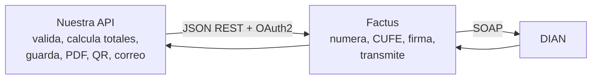
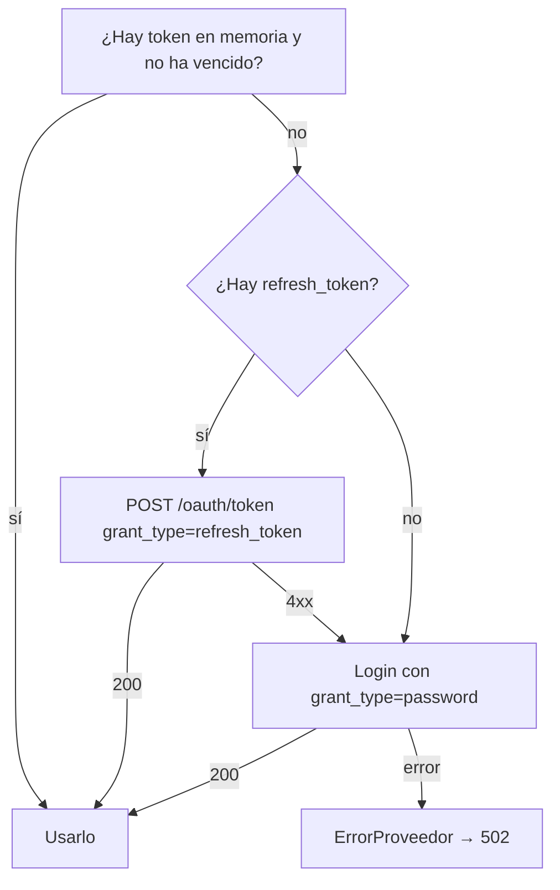

# 5. Integración con Factus (proveedor tecnológico)

> Objetivo: entender cómo la API delega la facturación en **Factus**, cómo conseguir y
> configurar credenciales del *sandbox*, y **qué no se ha podido verificar**.
> Decisión de diseño: [ADR-004](../decisions/ADR-004-proveedor-tecnologico-factus.md).

## 5.1 ¿Por qué un proveedor tecnológico?

Conectarse directo a la DIAN (software propio) exige RUT como facturador electrónico,
certificado de firma ONAC pagado y superar el set de pruebas. Un **proveedor tecnológico**
autorizado (como Factus) ya tiene todo eso: uno le envía los datos de negocio por una API
REST y él numera, calcula el CUFE, firma, transmite a la DIAN y devuelve el resultado.



## 5.2 Dónde está el código

| Pieza | Archivo | Rol |
|---|---|---|
| Puerto | `src/facturacion/proveedor/puertos.py` | `ProveedorFacturacion.emitir(factura, referencia) -> ResultadoEmision`; excepciones `ErrorProveedor` y `RechazoProveedor` |
| Adaptador | `src/facturacion/proveedor/factus.py` | `ClienteFactus` + funciones puras `construir_payload`, `interpretar_validacion`, `interpretar_xml`, `extraer_mensajes` |
| Selección | `src/facturacion/arranque.py:_proveedor` | Crea `ClienteFactus` si `FACTURACION_MODO=factus` |
| Uso | `src/facturacion/servicios/facturacion.py:_emitir_con_proveedor` | Arma la `Factura`, llama al proveedor y guarda el resultado |
| Errores HTTP | `src/facturacion/api/errores.py` | `RechazoProveedor` → 422, `ErrorProveedor` → 502 |
| Pruebas | `tests/unitarias/test_factus.py`, `tests/integracion/test_modo_proveedor.py` | Con `httpx.MockTransport` y un `ProveedorFalso`: sin red |

Por qué un puerto nuevo y no reutilizar `ClienteDian`: `ClienteDian` recibe un **XML ya
firmado**, mientras que Factus recibe **datos de negocio** en JSON. Los contratos no encajan.

## 5.3 Autenticación: OAuth2 *password grant* con renovación

Endpoint: `POST {FACTUS_URL}/oauth/token` con formulario (`application/x-www-form-urlencoded`).

| Momento | Campos enviados |
|---|---|
| Primer login | `grant_type=password`, `username`, `password`, `client_id`, `client_secret` |
| Renovación | `grant_type=refresh_token`, `refresh_token`, `client_id`, `client_secret` |

La respuesta trae `access_token`, `refresh_token` y `expires_in`. Lógica de
`ClienteFactus._token_vigente`:



Detalles:

- El token se guarda **solo en memoria** (`_Token`) y se considera vencido **30 s antes**
  (`MARGEN_EXPIRACION_SEGUNDOS`) para no usarlo justo cuando expira. Si `expires_in` no viene,
  se asumen 600 s.
- Un `threading.Lock` evita que dos hilos inicien sesión a la vez.
- Si una llamada recibe **401**, `_llamar_api` fuerza un login nuevo y **reintenta una sola vez**.

## 5.4 Emisión: `POST /v2/bills/validate`

`construir_payload` traduce la `Factura` de dominio al JSON de la API v2 de Factus
(los comentarios `//` son explicativos, no se envían):

```jsonc
{
  "reference_code": "API-3f2a…",          // único por factura (uuid4)
  "document": "01",                       // factura electrónica de venta
  "operation_type": "10",                 // estándar
  "send_email": false,                    // la API envía su propio correo
  "payment_details": [{"payment_form": "1", "payment_method_code": "10", "amount": "571200.00"}],
  "cash_rounding_amount": "0.00",
  "customer": {
    "identification_document_code": "13", // código DIAN del tipo de documento
    "identification": "1020304050",
    "legal_organization_code": "2",       // 1 jurídica (NIT), 2 natural
    "tribute_code": "ZZ",                 // no aplica
    "names": "María Pérez",
    "email": "maria@example.com",
    "municipality_code": "05001"          // DANE; se omite para extranjeros
  },
  "items": [{
    "code_reference": "HOST-1", "name": "Hosting anual",
    "quantity": "1.00", "discount_rate": "0.00", "price": "480000.00",
    "unit_measure_code": "94", "standard_code": "999",
    "taxes": [{"code": "01", "rate": "19.00"}]   // 01 = IVA
  }]
}
```

### Códigos de catálogo

La v2 de Factus usa **los mismos códigos DIAN/DANE** que el dominio, así que no hay tablas de
traducción:

| Concepto | Valor | Constante en `factus.py` |
|---|---|---|
| Tipo de documento del cliente | Lista 13.2.1 de la DIAN (`13`, `31`, `22`, `41`, `48`…) | `CODIGOS_DOCUMENTO_IDENTIDAD` |
| Documento | `01` factura de venta | `DOCUMENTO_FACTURA_VENTA` |
| Operación | `10` estándar | `OPERACION_ESTANDAR` |
| Organización | `1` jurídica / `2` natural (jurídica si el documento es `31` o `50`) | `ORGANIZACION_JURIDICA`, `ORGANIZACION_NATURAL` |
| Tributo del cliente | `ZZ` no aplica | `TRIBUTO_CLIENTE_NO_APLICA` |
| Impuesto | `01` IVA | `IMPUESTO_IVA` |
| Estándar del ítem | `999` estándar de adopción del contribuyente | `ESTANDAR_CONTRIBUYENTE` |
| Unidad de medida | `94` unidad | `LineaFactura.unidad_medida` |
| Municipio | DANE 5 dígitos | `adquiriente.codigo_municipio` |

Reglas extra: Factus admite **máximo 2 decimales** en cantidad y precio (si no, `RechazoProveedor`
antes de llamar); las notas se limpian de caracteres de control y se cortan a 500
caracteres (`observation`); con NIT se envía `dv`; `numbering_range_id` solo si se configuró
`FACTUS_RANGO_NUMERACION_ID`.

### Interpretación de la respuesta (`interpretar_validacion`)

De `data` se toman `number`, `cufe` (debe ser 96 hex), `numbering_range` (prefijo,
resolución, vigencia, desde/hasta), `links.qr` (debe empezar por `https://`) y `errors`.
Si faltan datos no esenciales se usan respaldos (prefijo = letras del número, vigencia = fecha
de emisión) y se registra una advertencia. También acepta la forma de la v1 (`data.bill`).

Luego `_descargar_xml` llama a `GET /v2/bills/{numero}/download-xml` y decodifica
`xml_base_64_encoded`. Es de **mejor esfuerzo**: si falla, la factura se guarda igual con XML
vacío y `GET /api/v1/facturas/{id}/xml` responde 404.

## 5.5 Mapeo de errores

Antes de llamar a Factus, `_emitir_con_proveedor` guarda un **registro pendiente**
(`estado=en_proceso`, `numero="PEND-<24 hex>"`, `cufe="pendiente-<24 hex>"` y
`datos.proveedor.referencia = "API-<24 hex>"`, el mismo `reference_code` enviado). Según la
respuesta, ese registro se actualiza o se borra:

| Lo que pasa con Factus | Excepción | Respuesta de nuestra API | Qué queda en la BD |
|---|---|---|---|
| 200/201 y validada | — | **201** con la factura | El pendiente pasa a `aceptada` con número y CUFE de Factus |
| Validada, pero el número o CUFE ya existen en la BD (`IntegrityError`) | `ErrorNegocio` | **422** "…quedó registrada para conciliación" | `error_envio` con número y CUFE de Factus en `datos.proveedor` |
| 200/201 con `is_validated: false` y mensajes de "rechazo" | `RechazoProveedor` | **422** | Nada (se borra el pendiente) |
| 400, 409 o 422 | `RechazoProveedor` | **422** | Nada |
| Datos no representables (más de 2 decimales, crédito sin vencimiento) | `RechazoProveedor` | **422** | Nada |
| 200/201 con `is_validated: false` sin rechazo (DIAN pendiente) | `ErrorProveedor` | **502** | `error_envio`, "concilie con la referencia API-…" |
| 401 persistente, credenciales rechazadas | `ErrorProveedor` | **502** | `error_envio` |
| 5xx, timeout, error de red, JSON inválido, CUFE o número inválidos, respuesta > 10 MiB | `ErrorProveedor` | **502** | `error_envio` |

Formato del 422 por rechazo (`api/errores.py:_rechazo_proveedor`; mensajes ilustrativos):

```json
{"detalle": [
  {"campo": "proveedor", "mensaje": "customer.identification: El campo es obligatorio"},
  {"campo": "proveedor", "mensaje": "errors: Regla: …, Rechazo: … (texto de la DIAN)"}
]}
```

Y el 502: `{"detalle": "El proveedor de facturación no está disponible"}`.

`extraer_mensajes` aplana `message`, `errors`, `data.errors` y `detail` (incluido el formato
`[{"loc": [...], "msg": "..."}]`), quita caracteres de control, corta cada mensaje a 300
caracteres, deja máximo 20 y `_redactar` reemplaza por `***` cualquier secreto reflejado.

**Por qué el pendiente:** si la respuesta de Factus se pierde (timeout) puede que Factus **sí**
haya emitido la factura. Guardar antes la referencia permite **conciliarla** en el portal de
Factus en vez de perderla. Por la misma razón `POST /api/v1/facturas/{id}/reintentar-envio`
responde **409** para facturas que pasaron por el proveedor: reenviar podría duplicarla. Un
rechazo explícito sí borra el pendiente, porque entonces no se emitió nada (y, como Factus
asigna la numeración, no se consumió ningún número propio).

Mientras dura la llamada, la factura aparece en el listado como `en_proceso` con número
`PEND-…`.

## 5.6 Cómo obtener credenciales del sandbox

Necesita cuatro datos: `client_id`, `client_secret`, usuario (correo) y contraseña.

1. Entre al portal de desarrolladores de Factus (<https://developers.factus.com.co>) y busque
   la sección de registro, sandbox o contacto.
2. Solicite a Factus (soporte o equipo comercial) acceso al **ambiente sandbox** para un
   proyecto académico. Pida explícitamente `client_id`, `client_secret`, usuario y contraseña,
   y pregunte si debe usar un **id de rango de numeración** específico.
3. Pregunte también qué **datos de empresa** tiene la cuenta sandbox, para poner los mismos en
   `EMISOR_*` (el PDF de nuestra API se arma con esas variables, no con los datos de Factus).

> **Importante:** durante el desarrollo **no se encontraron credenciales públicas oficiales**
> del sandbox en la documentación de Factus. Si encuentra unas "de ejemplo" en internet,
> confirme con Factus antes de usarlas. **Nunca** las suba a git, a un issue ni a un chat: van
> solo en `.env` (que está en `.gitignore`).

## 5.7 Activar el modo Factus

```ini
# .env
FACTURACION_MODO=factus
FACTUS_URL=https://api-sandbox.factus.com.co   # por defecto; debe ser https
FACTUS_CLIENT_ID=...
FACTUS_CLIENT_SECRET=...
FACTUS_USUARIO=...
FACTUS_CLAVE=...
# FACTUS_RANGO_NUMERACION_ID=8                 # opcional, entero ≥ 1
```

Reinicie `uvicorn`. Si falta una variable verá `Faltan variables para Factus: FACTUS_…` y la
app no arranca. Con `FACTURACION_MODO=factus` las variables `DIAN_*` y `NUMERACION_*` no se
usan para emitir. Para volver al modo propio: `FACTURACION_MODO=directo`.

Prueba rápida: emita una factura desde `/app/` o con el `curl` de la
[guía 4](04-como-usarlo.md#8-usar-curl). En el detalle, la respuesta dirá
"Validada por la DIAN a través de Factus" y el enlace de verificación apuntará al catálogo
de la DIAN.

## 5.8 Qué está verificado y qué no

| Aspecto | Estado |
|---|---|
| Formato de autenticación, payload y respuestas | Tomado de la documentación pública de Factus v2 (octubre de 2026) y cubierto con pruebas simuladas |
| Renovación de token, reintento tras 401, mapeo de errores, límites, redacción de secretos | Probado con `httpx.MockTransport` (`tests/unitarias/test_factus.py`) |
| Flujo completo dentro de la API (guardar, PDF, QR, correo, 422/502) | Probado con `ProveedorFalso` (`tests/integracion/test_modo_proveedor.py`) |
| **Llamada real al sandbox** | **No verificado**: el entorno en la nube donde se desarrolló bloqueaba el dominio de Factus |
| Comportamiento sin `FACTUS_RANGO_NUMERACION_ID` | No verificado (depende de la configuración de la cuenta) |
| Mensajes reales de rechazo de la DIAN vía Factus | No verificados; el filtro de "rechazo" en `interpretar_validacion` asume que el texto contiene esa palabra |
| IVA 0 % | Se envía como tarifa `0.00` (exento, como lo rotula la interfaz); el dominio no distingue "excluido" |
| Conciliación de facturas `error_envio` | Manual (portal de Factus, por `reference_code`); no hay consulta automática |

Recomendación antes de la sustentación: hacer al menos una emisión real contra el sandbox desde
un computador con acceso a internet y anotar el resultado.
