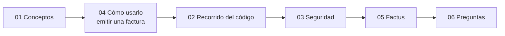

# Guía para entender el proyecto

Esta guía está pensada para leerse **de principio a fin** por alguien que no ha trabajado
nunca con facturación electrónica, y a la vez para **defender el proyecto** ante un jurado
técnico. Cada archivo se puede leer por separado.

| # | Archivo | Qué aprende | Tiempo |
|---|---|---|---|
| 1 | [Conceptos](01-conceptos.md) | Qué es una factura electrónica en Colombia, la DIAN, CUFE, UBL, XAdES, QR, habilitación, software propio vs. proveedor tecnológico. Glosario. | 20 min |
| 2 | [Recorrido del código](02-recorrido-del-codigo.md) | Arquitectura hexagonal, cada paquete, y el viaje completo de `POST /api/v1/facturas` en modo `directo` y `factus`, función por función. | 40 min |
| 3 | [Seguridad explicada](03-seguridad-explicada.md) | Cada control (Argon2id, JWT, rate limiting, IDOR, CSP, XXE, TLS…) explicado y mapeado al OWASP Top 10, más los riesgos que quedan. | 30 min |
| 4 | [Cómo usarlo](04-como-usarlo.md) | Instalar, configurar `.env`, crear el administrador, usar la interfaz web `/app/`, Swagger, `curl`, pruebas, Docker y solución de problemas. | 30 min (práctico) |
| 5 | [Factus sandbox](05-factus-sandbox.md) | Cómo funciona la integración con el proveedor tecnológico Factus, cómo conseguir credenciales y qué falta por verificar. | 15 min |
| 6 | [Preguntas para la sustentación](06-preguntas-para-la-sustentacion.md) | ~20 preguntas probables de un profesor, con respuestas modelo. | 20 min |

## Ruta sugerida

Consejo: después de leer los conceptos, **ejecute el proyecto y emita una factura** (guía 4).
Leer el código con una factura real en la pantalla es mucho más fácil.

## Resumen en cinco líneas

1. La API recibe los datos de una venta (`POST /api/v1/facturas`) de un usuario autenticado con JWT.
2. Calcula totales e IVA con `Decimal`, asigna un número consecutivo y calcula el **CUFE** (SHA-384).
3. En modo `directo` genera el XML **UBL 2.1**, lo firma con **XAdES-EPES** y lo envía a la DIAN
   (simulada o el ambiente de habilitación); en modo `factus` delega eso al proveedor tecnológico.
4. Guarda la factura y produce bajo demanda el **PDF** con **QR**, el XML y el correo al cliente.
5. El QR lleva a una página pública `/verificar/{cufe}` que confirma que la factura existe.

## Otra documentación del repositorio

- Índice técnico: [`docs/README.md`](../README.md)
- Arquitectura (resumen): [`docs/04-arquitectura/arquitectura.md`](../04-arquitectura/arquitectura.md)
- Contrato de la API: [`docs/06-contrato-api/endpoints.md`](../06-contrato-api/endpoints.md)
- Decisiones (ADR): [`docs/decisions/`](../decisions/)
- Modelo de amenazas: [`docs/security/modelo-de-amenazas.md`](../security/modelo-de-amenazas.md)
- Habilitación DIAN: [`docs/03-habilitacion/guia-habilitacion.md`](../03-habilitacion/guia-habilitacion.md)
