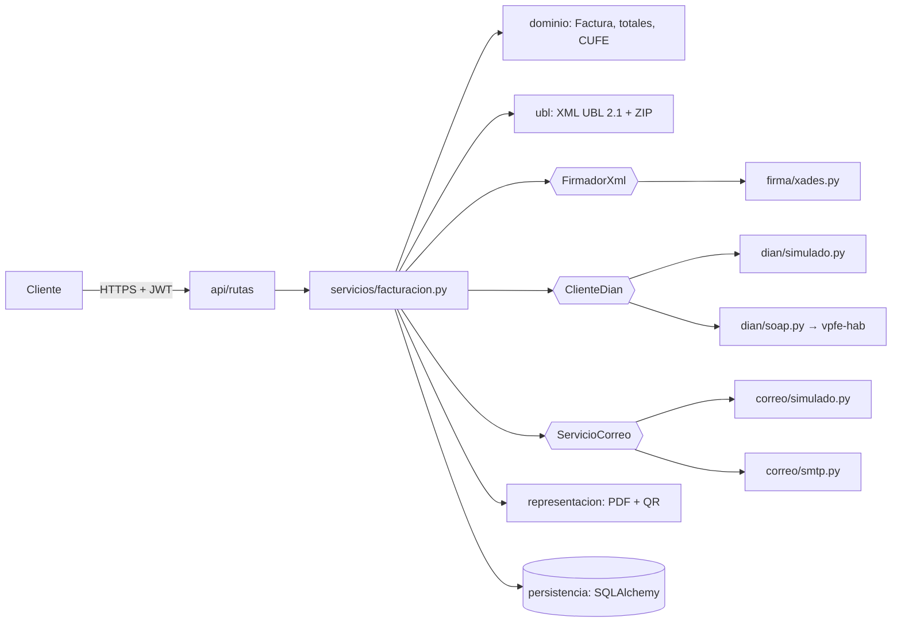

# Arquitectura

Monolito modular con **puertos y adaptadores** (ver [ADR-001](../decisions/ADR-001-stack-tecnologico.md)).

## Módulos (`src/facturacion/`)

| Módulo | Responsabilidad | Depende de |
|---|---|---|
| `dominio/` | Factura, líneas, totales con `Decimal`, CUFE, contenido del QR | nada |
| `ubl/` | XML UBL 2.1 con extensiones DIAN; nombres de archivo y ZIP | dominio |
| `firma/` | Puerto `FirmadorXml` y XAdES-EPES (Política de Firma v2) | lxml, signxml |
| `dian/` | Puerto `ClienteDian`; adaptador SOAP 1.2 + WS-Security y simulado | httpx, cryptography |
| `representacion/` | PDF (reportlab) y QR (segno) | dominio |
| `correo/` | Puerto `ServicioCorreo`; SMTP (TLS) y simulado (`.eml`) | stdlib |
| `persistencia/` | Modelos ORM y repositorios | SQLAlchemy |
| `seguridad/` | Argon2id, JWT, limitador de intentos | argon2-cffi, PyJWT |
| `servicios/` | Caso de uso de emisión y derivados | todos los puertos |
| `api/` | Rutas FastAPI, esquemas, errores, middleware | servicios |
| `arranque.py` | Raíz de composición: elige adaptadores según configuración | todo |

## Flujo de emisión (`POST /api/v1/facturas`)

1. Validación del cuerpo (Pydantic, `extra="forbid"`, límites de tamaño y formato).
2. Verificación de vigencia de la resolución y **consecutivo atómico** (`UPDATE … RETURNING`).
3. Cálculo de totales (ROUND_HALF_UP a 2 decimales) y **CUFE** SHA-384.
4. Generación del XML UBL con `DianExtensions` (resolución, SoftwareID,
   SoftwareSecurityCode, QR) y `UBLExtension[2]` vacío.
5. **Firma XAdES-EPES** dentro de `UBLExtension[2]`.
6. ZIP con nombre `fv{NIT}{000}{AA}{consecutivo hex}.xml` y envío a la DIAN.
7. Persistencia del XML firmado, la respuesta y el `ApplicationResponse`.

Estados: `aceptada`, `rechazada`, `en_proceso` (set de pruebas, consultar estado),
`error_envio` (reintentable).

## Derivados

- **PDF**: se regenera bajo demanda desde la instantánea JSON guardada (emisor y
  numeración vigentes al emitir), con QR en todas las páginas.
- **QR**: contenido del anexo + URL de verificación (propia o catálogo DIAN).
- **Correo**: solo facturas `aceptada`; adjunta un ZIP con PDF, XML firmado y
  `ApplicationResponse`; asunto `NIT;Razón social;Número;01;Razón social`.
