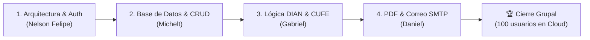

# 🎭 Guion Maestro de Sustentación por Roles — Grupo 5

> **Materia:** Cloud Computing Para El Desarrollo De Software  
> **Integrantes:**  
> • Nelson Felipe Gonzales Gordillo  
> • Daniel Esteban Alarcón Rojas  
> • Gabriel Felipe Bastidas Alvarado  
> • Michelt Carolina Camargo Cobo  
> **Proyecto:** API de Facturación Electrónica DIAN para Personas Naturales  
> **Duración estimada:** 8 a 10 minutos (2 a 2.5 min por integrante)  

---

## 🧭 Estrategia General de la Sustentación
Cada integrante sigue una secuencia de 3 pasos:
1. **💻 Código en VS Code:** Abre su archivo a cargo, muestra las líneas clave y explica la lógica.
2. **🧪 Demostración en Vivo:** Ejecuta sus peticiones correspondientes en **Postman** (o terminal en caso de pruebas) evidenciando el funcionamiento real y dinámico.
3. **❓ Pregunta Fija del Docente:** Responde con seguridad técnica la pregunta que el profesor suele hacer sobre ese componente.

---



---

## 👤 Integrante 1: Nelson Felipe Gonzales Gordillo
### Rol: Arquitectura, Ruteo y Seguridad JWT

#### 1. 💻 Código en VS Code:
* Abre el archivo **`app.py`**:
  * **Líneas 20-22:** Inicialización del objeto `app = Flask(__name__)` y configuración de la `SECRET_KEY` para la firma criptográfica.
  * **Líneas 27-46 (`@token_required`):** Explica que es una función decoradora que intercepta la petición, extrae el encabezado `Authorization: Bearer <token>`, valida la firma digital con `jwt.decode(..., algorithms=['HS256'])` y verifica que el token no haya expirado. Si falta o es inválido, rechaza inmediatamente con `401 Unauthorized`.
  * **Líneas 50-68 y 73-100:** Endpoint raíz `GET /` con metadatos del proyecto y endpoint `POST /login` que consulta la base de datos y genera el JWT con vigencia de 2 horas.

#### 2. 🧪 Demostración en Postman:
* **`01. Salud y Metadatos de la API` (`GET /`):** Muestra el estado del servicio y los nombres del Grupo 5.
* **`04. Intentar Crear Persona SIN Token` (`POST /personas`):** ➡️ **Demuestra el error `401 Unauthorized` ("Falta el token de autorización")** probando que los endpoints de modificación están blindados.
* **`03. Login Fallido` (`POST /login` con contraseña incorrecta):** ➡️ **Demuestra el error `401 Unauthorized` ("Credenciales inválidas")**.
* **`02. Login Exitoso` (`POST /login` con usuario `profe` y clave `cloud2026`):** ➡️ Responde `200 OK`, entrega el token JWT y resalta que el script automático de Postman guardó el token en la variable `{{token}}` para las siguientes peticiones.

#### 3. ❓ Pregunta Clave del Docente:
> **Profesor:** *"¿Por qué el decorador `@token_required` se coloca debajo de `@app.route` y no arriba?"*  
> **Respuesta:** *"Porque Flask necesita primero registrar la ruta en su mapa de URLs interno. Luego, al estar colocado justo encima de la función, Flask envuelve la vista con la validación de seguridad antes de que se ejecute la lógica de negocio."*

---

## 👤 Integrante 2: Michelt Carolina Camargo Cobo
### Rol: Persistencia en SQLite, Modelado de Datos y Prevención SQL Injection

#### 1. 💻 Código en VS Code:
* Abre el archivo **`database.py`**:
  * **Líneas 10-15 (`get_db`):** Conexión nativa con SQLite habilitando `conn.row_factory = sqlite3.Row` para manipular columnas como diccionarios.
  * **Líneas 25-50 (`init_db`):** Creación de tablas relacionales: `usuarios`, `personas` (Recurso principal con 6 campos propios: `nombre`, `rut`, `cedula UNIQUE`, `direccion`, `correo`, `telefono`) y `facturas`.
* Abre el archivo **`app.py` (Líneas 106-200):**
  * Muestra los endpoints del CRUD de Personas (`GET`, `POST`, `PUT`, `DELETE`).
  * Destaca que todas las consultas usan **parámetros con marcadores `?`**, evitando completamente la concatenación directa de cadenas.

#### 2. 🧪 Demostración en Postman:
* **`05. Crear Persona Natural (Burnice White)` (`POST /personas`):** ➡️ Registra a Burnice White (`burnice.white2305@gmail.com`), responde `201 Created` y guarda automáticamente el ID en `{{persona_id}}`.
* **`06. Listar Todas las Personas Naturales` (`GET /personas`):** ➡️ Demuestra la lectura de todos los clientes persistidos en SQLite.
* **`07. Consultar Persona por ID` (`GET /personas/{{persona_id}}`):** ➡️ Consulta puntual por clave primaria del cliente recién creado.
* **`08. Actualizar Persona Natural` (`PUT /personas/{{persona_id}}`):** ➡️ Modifica el teléfono y la dirección demostrando la actualización con el verbo `PUT`.

#### 3. ❓ Pregunta Clave del Docente:
> **Profesor:** *"¿Cómo garantiza su implementación que un atacante no pueda inyectar código SQL?"*  
> **Respuesta:** *"A través de consultas preparadas con marcadores de posición `?`. SQLite precompila la estructura de la consulta y trata cualquier dato del usuario estrictamente como texto plano literal, neutralizando cualquier intento de inyección de código SQL."*

---

## 👤 Integrante 3: Gabriel Felipe Bastidas Alvarado
### Rol: Lógica Tributaria DIAN, Cálculo del CUFE y Pruebas Automatizadas

#### 1. 💻 Código en VS Code:
* Abre el archivo **`facturacion_servicio.py`**:
  * **Líneas 20-37 (`calcular_impuestos`):** Muestra que los cálculos son **100% dinámicos** (nada quemado):
    * IVA (19%): `round(subtotal * 0.19, 2)`
    * Total: `Subtotal + IVA`
    * 4x1000 informativo: `round(total * 0.004, 2)` → lo retiene el banco al pagar (arts. 871-874 E.T.), no se suma a la factura
  * **Líneas 39-46 (`generar_cufe`):** Explica la fórmula del Código Único de Facturación Electrónica mediante el algoritmo hash criptográfico **SHA-256**, concatenando número, fecha/hora, importes, NIT emisor, cédula adquiriente y clave técnica.
* Abre **`app.py` (Líneas 205-240):** Muestra la consulta relacional con `JOIN` entre `facturas` y `personas`.
* Abre **`tests/test_api_facturacion.py`:** Muestra la suite de 11 pruebas unitarias y de integración.

#### 2. 🧪 Demostración en Vivo:
* **En la Terminal:** Ejecuta las pruebas automatizadas:
  ```powershell
  python -m pytest tests/test_api_facturacion.py -v
  ```
  ➡️ **Muestra las 11 pruebas pasando en verde al 100% en ~2 segundos**.
* **En Postman:**
  * **`09. Emitir Factura DIAN para Burnice White` (`POST /facturas`):** Envía un subtotal de $3,500,000 COP y muestra el desglose: IVA ($665,000), Total ($4,165,000) y el 4x1000 informativo ($16,660, no sumado), consecutivo `SETP-XXXX` y el CUFE de 64 caracteres.
  * **`10. Listar Facturas con Adquiriente (JOIN)` (`GET /facturas`):** Muestra el listado de facturas vinculadas con el nombre y cédula del cliente.
  * **`11. Consultar Detalle de Factura por ID` (`GET /facturas/{{factura_id}}`):** Consulta puntual de la factura emitida.

#### 3. ❓ Pregunta Clave del Docente:
> **Profesor:** *"¿Para qué sirve el CUFE si ya tenemos un consecutivo como SETP-0001?"*  
> **Respuesta:** *"El consecutivo es solo para control secuencial interno. El CUFE es la huella digital criptográfica: si alguien altera aunque sea un solo centavo en la base de datos, el hash SHA-256 no coincidirá y la DIAN rechazará la factura por violación de integridad."*

---

## 👤 Integrante 4: Daniel Esteban Alarcón Rojas
### Rol: Generación de PDF en Memoria, Servicio SMTP de Correo y Ciclo de Vida

#### 1. 💻 Código en VS Code:
* Abre **`facturacion_servicio.py` (Líneas 48-245 - `generar_pdf_factura`):**
  * Explica el uso de **ReportLab** construyendo el PDF sobre un buffer en memoria RAM (`io.BytesIO()`) sin escribir archivos temporales en el disco duro del servidor.
  * Destaca el diseño corporativo: membrete DIAN, resolución, datos de Burnice White, tabla de conceptos, liquidación tributaria y bloque del CUFE.
* Abre **`correo_servicio.py`**:
  * Muestra el uso de `smtplib` nativo conectándose a `smtp.gmail.com:587` con encriptación `server.starttls()`.
  * Explica cómo se construye el mensaje MIME multipart con el cuerpo HTML y el archivo PDF adjunto (`MIMEApplication`).
* Abre **`app.py` (Líneas 330-360):** Muestra el endpoint de anulación oficial de la factura (`DELETE /facturas/<id>`).

#### 2. 🧪 Demostración en Postman y Navegador:
* **`12. Descargar PDF Oficial de la Factura` (`GET /facturas/{{factura_id}}/pdf`):**
  * Abre la URL en el navegador: `http://localhost:5000/facturas/1/pdf` (o "Send and Download" en Postman) ➡️ **Muestra el PDF oficial generado con diseño profesional**.
* **`13. Enviar Factura al Correo de Burnice White` (`POST /facturas/{{factura_id}}/enviar-correo`):**
  * Ejecuta la petición y muestra la respuesta exitosa confirmando el despacho hacia `burnice.white2305@gmail.com` con el PDF adjunto.
* **`14. Anular Factura Electrónica (DELETE)` (`DELETE /facturas/{{factura_id}}`):**
  * Demuestra el ciclo de vida de la factura cambiando su estado a `ANULADA`.

#### 3. ❓ Pregunta Clave del Docente:
> **Profesor:** *"¿Por qué generaron el PDF en memoria con `io.BytesIO()` en lugar de guardarlo en una carpeta del servidor?"*  
> **Respuesta:** *"Por principios fundamentales de Cloud Computing: los servidores de aplicaciones deben ser stateless (sin estado). Guardar archivos locales satura el almacenamiento y en un clúster con múltiples instancias una máquina no vería los archivos de la otra. Generarlo en memoria RAM y entregarlo por streaming es más rápido, seguro y escalable."*

---

## 🏆 Cierre Grupal: La Pregunta de Oro (Diapositiva 36)

Cuando el docente formule la pregunta de cierre de las diapositivas de clase:
> **Profesor:** *"¿Qué tendrían que cambiar para que 100 personas usaran su API al mismo tiempo?"*

Cualquiera del grupo (o Daniel para rematar) expone los **4 Pilares de Escalabilidad en Cloud**:

1. **Servidor WSGI de Producción:** Reemplazar el servidor de desarrollo de Flask (`app.run`) por **Gunicorn / uWSGI**, configurando múltiples procesos (*workers*) e hilos (*threads*) para atender peticiones en paralelo.
2. **Base de Datos Cliente-Servidor:** Migrar de SQLite a un motor relacional como **PostgreSQL** o **MySQL**, ya que SQLite bloquea el archivo completo en operaciones de escritura y colapsaría con accesos concurrentes.
3. **Pool de Conexiones (Connection Pooling):** Implementar reciclaje de conexiones activas para que el servidor no gaste recursos abriendo y cerrando conexiones TCP por cada request.
4. **Escalabilidad Horizontal y Balanceo:** Empaquetar la API en contenedores Docker y desplegarla en servicios administrados de Nube (**AWS ECS**, **Google Cloud Run** o **Kubernetes**) detrás de un **Balanceador de Carga (Load Balancer)** que distribuya el tráfico entre múltiples instancias réplica.

---

## ⚡ Comandos Rápidos de Verificación

```powershell
# 1. Instalar dependencias
pip install -r requirements.txt

# 2. Correr pruebas automatizadas
python -m pytest tests/test_api_facturacion.py -v

# 3. Encender la API local
python app.py
```
